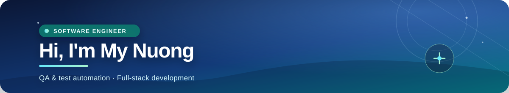
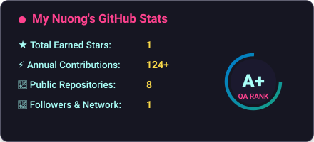
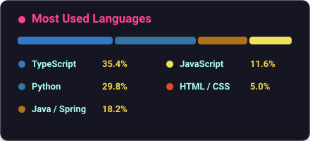

  

   

  

  

    
    
    
  

  

    
    
    
    
  

 

## Hello, I'm Nuong 👋

I am a Software Engineering student at **Ho Chi Minh City University of Technology and Education**, graduating in **2027**. I care about the details that make software trustworthy: clear product flows, thoughtful test coverage, and interfaces that feel easy to use.

My focus sits at the intersection of **quality assurance, test automation, and full-stack development**. I use Playwright, Postman, and Selenium to find edge cases early, while building with Spring Boot, React, TypeScript, and Python.

| Quality mindset | Product mindset | Growth mindset |
| :---: | :---: | :---: |
| E2E testing · API validation | UI/UX · accessibility | AI-assisted QA · CI/CD |

## Selected work

<table>
  <tr>
    <td width="50%" valign="top">
      <h3>🎬 <a href="https://github.com/tranthimynuong/Aegisub-AI-Studio">Aegisub-AI-Studio</a></h3>
      
<strong>AI subtitle automation & multimedia processing</strong>

      
Combines Faster-Whisper CUDA, RapidOCR ONNX, Gemini/DeepSeek translation, VieNeu-TTS voiceover, and FFmpeg processing into an end-to-end studio workflow.

      Python · CUDA · OCR · Gemini AI · FFmpeg · Lua
    </td>
    <td width="50%" valign="top">
      <h3>📚 <a href="https://github.com/tranthimynuong/Minlish_doanoop">Minlish_doanoop</a></h3>
      
<strong>Vocabulary learning platform & analytics</strong>

      
Built around spaced repetition, AI-generated context, interactive learning metrics, and Playwright E2E coverage for real user journeys.

      React 19 · TypeScript · Tailwind CSS · Playwright · Vite
    </td>
  </tr>
  <tr>
    <td width="50%" valign="top">
      <h3>🎓 <a href="https://github.com/tranthimynuong/Topichub">Topichub</a></h3>
      
<strong>Academic forum & collaborative knowledge sharing</strong>

      
Designed a structured discussion platform with role-based access control, relational domain models, nested comments, and API test collections.

      Java 17 · Spring Boot · MySQL · Postman · Docker
    </td>
    <td width="50%" valign="top">
      <h3>⚡ <a href="https://github.com/tranthimynuong/quizmaster">quizmaster</a></h3>
      
<strong>Real-time examination engine & analytics</strong>

      
Handles synchronized timers, dynamic question pools, automatic submission, tab-switch detection, reconnects, and instant diagnostic results.

      React · JavaScript · Node.js · Tailwind CSS · Vercel
    </td>
  </tr>
</table>

## Toolbox

 
Java · Spring Boot · TypeScript · React · Python · Playwright · Postman · Selenium · SQL · Docker · Git · Figma

## GitHub activity

  
  

 

  <picture>
    <source media="(prefers-color-scheme: dark)" srcset="https://raw.githubusercontent.com/tranthimynuong/tranthimynuong/output/github-contribution-grid-snake-dark.svg" />
    <source media="(prefers-color-scheme: light)" srcset="https://raw.githubusercontent.com/tranthimynuong/tranthimynuong/output/github-contribution-grid-snake.svg" />
    
  </picture>

## A little more about me

- 🎯 **Career direction:** QA / Automation Testing and Software Engineering internships.
- 🧪 **Current interests:** AI-assisted test generation, mutation testing, and security checks in CI pipelines.
- 🌐 **English:** VSTEP B2 (32/40) · TOEIC 590.
- 🤝 **Working style:** collaborative, detail-oriented, and always looking for the simplest reliable solution.

 

### Let's build something reliable together.

  

